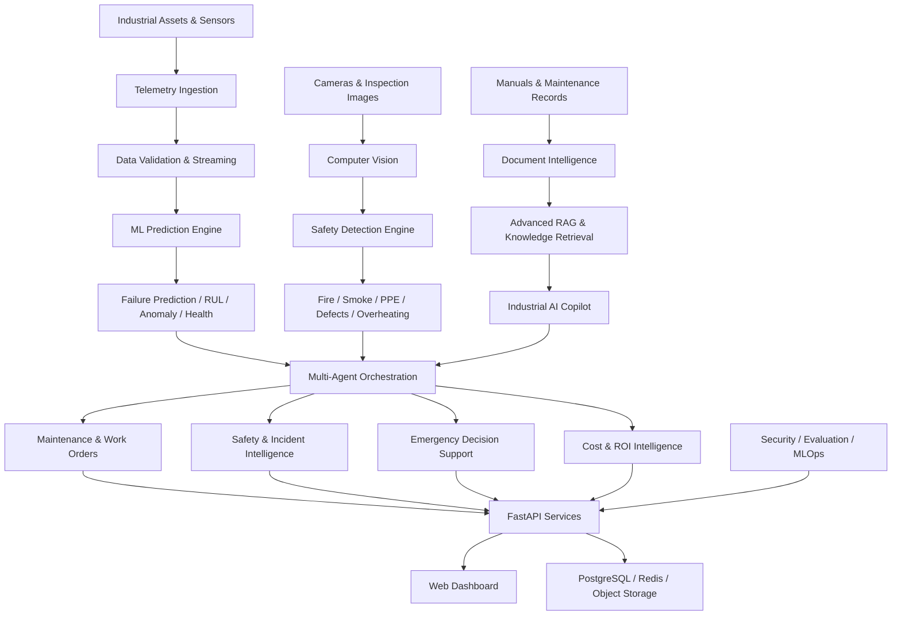

# Industrial Predictive Maintenance, Safety & Emergency Intelligence AI

### An End-to-End Industrial AI Platform for Asset Reliability, Worker Safety, Emergency Intelligence & Cost Optimization

**Machine Learning · Deep Learning · Computer Vision · Industrial IoT · Generative AI · Advanced RAG · Multi-Agent AI · FastAPI · MLOps · Cloud**

[](https://www.python.org/)
[](https://fastapi.tiangolo.com/)
[](https://www.postgresql.org/)
[](https://www.docker.com/)
[](https://pytest.org/)
[](LICENSE)

> **Project status:** Portfolio development. Features and integrations described below represent the intended platform architecture; implementation and performance must be verified before marking them production-ready.

## Overview

Industrial organizations face costly equipment failures, unplanned downtime, workplace hazards, inefficient maintenance schedules, and limited visibility into the financial consequences of asset degradation.

**Industrial Predictive Maintenance, Safety & Emergency Intelligence AI** is an integrated AI engineering project designed to address these challenges through real-time industrial telemetry, machine learning, computer vision, intelligent maintenance recommendations, emergency decision support, and financial cost analysis.

Rather than treating predictive maintenance, safety monitoring, and asset cost management as separate applications, the platform combines them into a unified industrial intelligence architecture.

### Core capabilities

- **Predictive maintenance:** Equipment failure prediction, anomaly detection, remaining useful life (RUL), and asset health scoring.
- **Industrial IoT:** Sensor ingestion, streaming telemetry, MQTT, Kafka, and optional OPC-UA integration.
- **Computer vision:** Fire, smoke, overheating, worker motion, PPE, cracks, corrosion, and equipment defect analysis.
- **Safety intelligence:** Risk scoring, restricted-zone monitoring, event correlation, incident classification, and alert management.
- **Emergency intelligence:** Evidence-based response recommendations, incident escalation, and human-reviewed response workflows.
- **Cost intelligence:** Repair and replacement estimation, downtime losses, future maintenance costs, asset lifecycle analysis, and ROI.
- **Generative AI:** Industrial knowledge assistant powered by LLMs, advanced retrieval, document intelligence, and citations.
- **Agentic AI:** Specialized agents for maintenance, inspection, safety, incidents, emergency planning, and financial analysis.
- **MLOps and security:** Model evaluation, monitoring, drift analysis, authentication, RBAC, audit logging, and secure deployment.

## The Real-World Problem

| Industrial challenge | Proposed AI solution | Business value |
|---|---|---|
| Unexpected equipment failure | Failure prediction and RUL models | Earlier maintenance planning |
| Unplanned downtime | Risk-aware maintenance scheduling | Reduced disruption |
| Poor asset visibility | Continuous telemetry and health scoring | Improved operational awareness |
| Fire and smoke hazards | Computer vision and sensor-based detection | Earlier hazard awareness |
| Worker safety incidents | PPE and restricted-zone monitoring | Better safety oversight |
| High maintenance costs | Repair-versus-replace intelligence | More informed spending decisions |
| Fragmented technical manuals | Industrial RAG with citations | Faster information retrieval |
| Delayed incident response | Incident correlation and decision support | More consistent response workflows |
| Uncertain future expenses | Cost forecasting and scenario analysis | Better budgeting |

## System Architecture



**Safety architecture:** AI-generated decisions are advisory. Physical equipment shutdown, relay actuation, emergency dispatch, and other safety-critical operations remain disabled by default and require independent authorized safety systems.

## 1. Predictive Maintenance & Asset Health

The predictive maintenance subsystem is designed to analyze industrial sensor data and equipment history to identify degradation and estimate future maintenance requirements.

**Planned capabilities:**

- Failure probability prediction using supervised learning.
- Anomaly detection using statistical methods, Isolation Forest, and autoencoders.
- RUL estimation using regression, survival analysis, or sequence models.
- Equipment health scores based on telemetry, operating history, and risk.
- Early warning and critical-risk classification.
- Maintenance recommendations with supporting evidence.
- Historical trend visualization and model explainability.

**Example inputs:** Temperature, vibration, current, voltage, pressure, humidity, operating hours, fault history, and maintenance records.

**Example output:**

```json
{
  "asset_id": "MOTOR-001",
  "health_score": 62,
  "failure_probability": 0.38,
  "predicted_rul_hours": 420,
  "risk_level": "high",
  "maintenance_recommended": true,
  "model_version": "example-model"
}
```

*Illustrative output only, not a real prediction.*

## 2. Industrial Computer Vision & Safety

The computer vision subsystem is intended to process camera feeds and inspection images for safety events and equipment defects.

**Detection categories:** Fire, smoke, visible overheating indicators, PPE compliance, personnel presence, restricted-zone intrusion, motion anomalies, cracks, corrosion, and surface defects.

The system is designed to support confidence scoring, bounding-box visualization, event history, and correlation with industrial sensor measurements.

Computer vision alerts are not substitutes for certified fire detection, thermal protection, or industrial safety systems.

## 3. Industrial Emergency Intelligence

The emergency intelligence module connects detected safety events with incident workflows and response recommendations.

Its proposed workflow is:

1. Receive a safety event from telemetry, vision, or an authorized operator.
2. Validate the event and correlate supporting evidence.
3. Classify incident type, severity, and affected assets.
4. Retrieve relevant emergency procedures and technical documentation.
5. Generate a suggested response plan for authorized personnel.
6. Record decisions, escalations, acknowledgments, and audit history.

The system must not independently control industrial machinery or dispatch emergency services without approved external integrations and human authorization.

## 4. Repair, Replacement & Cost Intelligence

The financial intelligence engine is designed to combine engineering risk with cost analysis.

**Cost categories:**

- Spare parts and replacement components
- Technician labor
- Equipment repair and replacement
- Production downtime and lost output
- Energy consumption
- Scrap and material losses
- Emergency response costs
- Expected future failures
- Asset lifecycle and depreciation
- Return on investment

A simplified example:

| Cost factor | Repair | Replacement |
|---|---:|---:|
| Direct expenditure | ₹35,000 | ₹1,50,000 |
| Expected downtime | ₹15,000 | ₹10,000 |
| Future risk-adjusted cost | ₹25,000 | ₹5,000 |
| **Illustrative total** | **₹75,000** | **₹1,65,000** |

The recommendation engine should compare options over a consistent planning horizon, account for uncertainty, and explain its assumptions. Financial estimates are advisory and require business validation.

## 5. Industrial Generative AI & Advanced RAG

The industrial AI copilot is designed to answer technical questions using equipment manuals, standard operating procedures, inspection records, and maintenance history.

**Proposed retrieval pipeline:**

Document ingestion → OCR and text extraction → Chunking → Embeddings → Hybrid retrieval (BM25 + vector) → Reranking → Evidence selection → LLM response → Citation validation.

Advanced retrieval options include multi-query retrieval, parent-child retrieval, knowledge graphs, and corrective retrieval.

**Example questions:**

- What are the likely causes of increased vibration in Motor-001?
- Which maintenance procedure applies to this pump model?
- What inspection evidence supports the current asset health score?
- How does predicted downtime affect repair-versus-replacement cost?
- Which safety procedures apply to a suspected overheating event?

The assistant should distinguish documented facts, model predictions, and uncertain recommendations.

## 6. Multi-Agent Industrial Intelligence

The proposed agent architecture separates responsibilities into specialized components:

| Agent | Responsibility |
|---|---|
| Supervisor Agent | Coordinate requests and review workflow results |
| Asset Health Agent | Analyze asset condition and degradation |
| Predictive Maintenance Agent | Interpret failure risk and RUL |
| Inspection Agent | Analyze equipment images and defects |
| Safety Agent | Correlate safety detections and risk |
| Incident Agent | Classify and summarize incidents |
| Emergency Agent | Retrieve procedures and propose response steps |
| Cost Intelligence Agent | Estimate maintenance and downtime costs |
| Repair/Replacement Agent | Compare asset management options |
| Report Agent | Generate evidence-based technical reports |

Agent tools should be permission-restricted, logged, and evaluated for correctness. High-impact actions require human approval.

## Technology Stack

| Layer | Technologies |
|---|---|
| Backend | Python, FastAPI, Pydantic, SQLAlchemy |
| Frontend | React, TypeScript, HTML, CSS |
| Databases | PostgreSQL, Redis |
| ML | Scikit-learn, XGBoost, LightGBM |
| Deep Learning | PyTorch |
| Computer Vision | OpenCV, YOLO-style detection models |
| Industrial IoT | MQTT, Kafka, OPC-UA |
| GenAI | OpenAI-compatible APIs, Hugging Face, Ollama |
| RAG | Sentence Transformers, Qdrant, FAISS, BM25 |
| Agents | LangGraph-style orchestration, tool calling |
| MLOps | MLflow, model versioning, drift monitoring |
| Infrastructure | Docker, Docker Compose, AWS concepts |
| Monitoring | Prometheus, Grafana, OpenTelemetry |
| Testing | Pytest, pytest-asyncio, pytest-cov |
| Security | JWT, RBAC, audit logging, input validation |

*Technology inclusion does not imply that every integration is already implemented.*

## Repository Structure

```text
industrial-predictive-maintenance-safety-emergency-ai/
├── backend/
│   ├── app/
│   │   ├── api/
│   │   ├── core/
│   │   ├── auth/
│   │   ├── models/
│   │   ├── services/
│   │   ├── telemetry/
│   │   ├── ml/
│   │   ├── cv/
│   │   ├── safety/
│   │   ├── incidents/
│   │   ├── emergency/
│   │   ├── maintenance/
│   │   ├── cost/
│   │   ├── rag/
│   │   ├── agents/
│   │   └── security/
│   └── Dockerfile
├── frontend/
├── alembic/
│   └── versions/
├── configs/
├── data/
├── docs/
├── infra/
├── models/
├── reports/
├── scripts/
├── tests/
│   ├── unit/
│   ├── integration/
│   ├── api/
│   └── security/
├── .env.example
├── .dockerignore
├── alembic.ini
├── docker-compose.yml
├── Makefile
├── pyproject.toml
├── LICENSE
└── README.md
```

*Illustrative target structure. Keep this tree synchronized with the actual repository.*

## Getting Started

### Prerequisites

- Python 3.11 or 3.12
- Docker and Docker Compose
- Git
- Node.js for the frontend
- PostgreSQL and Redis, if running services locally

### Clone the repository

```bash
git clone https://github.com/pa-mohammed-hamil/industrial-predictive-maintenance-safety-emergency-ai.git
cd industrial-predictive-maintenance-safety-emergency-ai
```

*Replace the URL if the repository has not been published under this name.*

### Configure the environment

```bash
cp .env.example .env
```

Edit `.env` and provide secure database credentials, JWT secrets, and any required API keys.

### Install Python dependencies

```bash
python -m venv .venv
python -m pip install -e ".[dev]"
```

Activate the virtual environment before installation where appropriate.

### Start the application

```bash
docker compose config --quiet
docker compose up -d --build
```

The proposed local endpoints are:

- Backend: `http://localhost:8000`
- API documentation: `http://localhost:8000/docs`
- Frontend: `http://localhost:3000`
- MLflow: `http://localhost:5000`

These commands require the Dockerfiles and supporting configurations to be implemented and tested.

## Testing & Quality Assurance

The testing strategy covers the complete industrial AI lifecycle.

**Unit testing:** Asset services, health scoring, failure prediction, anomaly detection, RUL, fire/smoke detection, overheating, motion analysis, cost calculations, repair/replacement decisions, and validation logic.

**Integration testing:** Telemetry ingestion, safety event processing, incident pipelines, cost pipelines, and database interactions.

**API and security testing:** Authentication, RBAC, file upload validation, prompt injection defenses, tenant isolation, and endpoint behavior.

Run tests with:

```bash
python -m pytest tests -v
```

Generate coverage:

```bash
python -m pytest tests --cov=app --cov-report=term-missing
```

### Verified test results

| Metric | Result |
|---|---|
| Total tests executed | Pending verification |
| Passing tests | Pending verification |
| Code coverage | Pending verification |
| API integration tests | Pending verification |
| Security test results | Pending verification |

Do not replace these values with estimates. Publish the results from actual CI or local test execution.

## AI Model Evaluation

Model evaluation is a central part of this project.

| Component | Evaluation metrics |
|---|---|
| Failure prediction | Precision, recall, F1, ROC-AUC, PR-AUC |
| Anomaly detection | Precision, recall, false alarm rate |
| RUL prediction | MAE, RMSE, calibration, error by operating regime |
| Fire/smoke detection | Precision, recall, mAP, false alarms per hour |
| Asset health | Calibration, trend stability, expert agreement |
| Cost estimation | MAE, MAPE where appropriate, prediction intervals |
| RAG | Recall@K, MRR, NDCG, faithfulness, citation accuracy |
| Agents | Task success, tool correctness, safety compliance |
| APIs | Latency, throughput, error rate |
| Security | Authorization coverage, injection resistance |

**Benchmark status:** Awaiting reproducible experiments using representative datasets.

## Security & Responsible Industrial AI

The platform is designed with defense-in-depth controls, including JWT authentication, role-based permissions, tenant separation, input validation, secure file processing, prompt-injection defenses, audit logs, and secrets management.

For industrial deployments, additional safeguards are essential:

- Read-only integration with industrial control systems by default.
- Human approval for consequential maintenance and emergency actions.
- Independent certified safety equipment and procedures.
- No direct autonomous physical actuation by LLM agents.
- Fail-safe behavior when sensors, networks, or AI services are unavailable.
- Clear distinction between simulated data and operational data.
- Controlled deployment, rollback, and model versioning.

**This software is not certified as an industrial safety system and should not be relied on as the sole means of protecting people, equipment, or facilities.**

## Screenshots & Demonstrations

Add real screenshots and recordings as the project becomes functional.

| Demonstration | Status |
|---|---|
| Industrial operations dashboard | Pending |
| Live sensor telemetry | Pending |
| Predictive maintenance dashboard | Pending |
| RUL and asset health analytics | Pending |
| Fire/smoke computer vision | Pending |
| Incident management workflow | Pending |
| Cost intelligence dashboard | Pending |
| Industrial RAG assistant | Pending |
| Multi-agent workflow | Pending |
| Test and evaluation dashboard | Pending |

Suggested demo scenario: A simulated motor exhibits rising vibration and temperature. The platform ingests telemetry, identifies anomalous behavior, generates a maintenance risk assessment, estimates downtime costs, retrieves the applicable maintenance procedure, and presents an auditable recommendation to a human operator.

## Engineering Roadmap

- [ ] Implement and validate the FastAPI backend.
- [ ] Integrate PostgreSQL and Alembic migrations.
- [ ] Implement simulated and real-time telemetry ingestion.
- [ ] Train and benchmark predictive maintenance models.
- [ ] Evaluate RUL estimation against run-to-failure data.
- [ ] Integrate computer vision safety models.
- [ ] Implement incident and emergency advisory workflows.
- [ ] Build deterministic cost calculation services.
- [ ] Implement grounded industrial RAG with citations.
- [ ] Integrate restricted multi-agent orchestration.
- [ ] Add end-to-end API and security tests.
- [ ] Build dashboards and publish demonstration videos.
- [ ] Add CI/CD and reproducible deployment documentation.
- [ ] Publish verified evaluation and performance metrics.

## Why This Project Matters

This project explores how multiple AI engineering disciplines can work together to solve interconnected industrial problems.

Its key architectural distinction is the combination of **equipment reliability, safety monitoring, emergency decision support, and financial intelligence** within one modular platform.

The project is intended to demonstrate end-to-end engineering skills across data ingestion, ML/DL inference, computer vision, RAG, multi-agent workflows, backend APIs, testing, security, observability, and deployment.

## Author

**PA Mohammed Hamil**

AI / Generative AI / Machine Learning Engineer

BCA Graduate (2026) · Kerala, India

GitHub: [pa-mohammed-hamil](https://github.com/pa-mohammed-hamil)

**Areas of focus:** Advanced Machine Learning, Deep Learning, Computer Vision, Generative AI, Agentic AI, Industrial IoT, MLOps, AI Security, and Cloud Engineering.

## License

This project is licensed under the [MIT License](LICENSE).

Copyright © 2026 PA Mohammed Hamil.

---

**Built to explore reliable, explainable, and safety-aware AI engineering for real-world industrial operations.**
